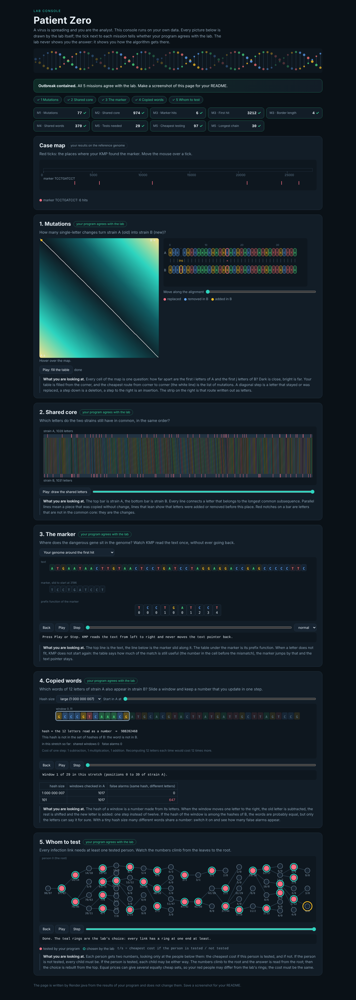

# Assignment 4. Patient Zero

Student ID: 252646
Name: Bogdan Tkachuk
Group: SE-2511

This file is the report. Fill it in as you go. How to start: `START_HERE.md`. The task: `docs/Assignment4.pdf`.

## Program output

The 9 lines your program prints on your data (`java -cp out Main`):

    Mutations: 77
    Shared core: 974
    Marker hits: 6
    First hit: 3212
    Border length: 4
    Shared words: 370
    Tests needed: 29
    Cheapest testing: 97
    Longest chain: 30

My outbreak report (a screenshot of `output/outbreak.html`):

## Questions

Answer in your own words, two or three sentences each.

Mission 1. What does the cell d[i][j] of your table mean, and how is it computed from other cells?

d[i][j] is the smallest number of changes that turn the first i letters of A into the first j letters of B. Row 0 is j insertions and column 0 is i deletions. Every other cell is the minimum of three: d[i-1][j-1] (plus 1 if the two letters are different: keep or replace), d[i-1][j] + 1 (delete a letter of A) and d[i][j-1] + 1 (insert a letter of B). The answer is the last cell d[n][m], for me 77.

Mission 2. How is the longest common subsequence different from the longest common substring? My Shared core is bigger than the number of letters that are the same at the same place: why?

A substring is a piece with no gaps, a subsequence keeps the order of the letters but may skip letters. In the table equal letters take the diagonal plus 1, different letters take the bigger of the top and the left cell. Only 252 letters of my strains are equal at the same place, but the Shared core is 974: B has insertions and deletions, so after the first one the letters are shifted, and the subsequence can skip letters and still match them in order.

Mission 3. What does the prefix function tell you, and why does the pointer in the text never go back in KMP? What is the Border length of my marker and what does it mean?

pi[i] is the length of the longest proper prefix of the first i+1 letters of the marker that is also their suffix. In KMP I keep k, the number of marker letters matched; on a mismatch k becomes pi[k-1], because the end of what was matched is already a beginning of the marker, so the text letters are not read again and the pointer only moves forward (O(n + m)). After a full match k becomes pi[m-1], so overlapping hits are found too. My marker TCCTGATCCT has Border length 4: TCCT is both its beginning and its end, so two hits can share these 4 letters.

Mission 4. Why must you compare the letters after the hashes are equal? What happens to the cost of Rabin-Karp if many windows have the same hash?

The hash is taken modulo MOD, so two different words can get the same number (a collision): equal hashes only mean "maybe equal", different hashes mean "surely different". So I compare the 12 letters before I count a position; with MOD = 7 my program still gives 370. If many windows have the same hash, almost every lookup compares letters, and the time grows from O(n + m) towards O(n * k) or more.

Mission 5. What are the two states of a person in your DP, and how do you get the answer for a person from its children? Why does a greedy "test the person with most links first" not always give the cheapest answer?

For every person v (the tree is rooted in person 0) I keep tested[v] = cost[v] + the sum of min(tested, notTested) of the children, and notTested[v] = the sum of tested of the children, because a link to a person who is not tested must be covered by the child. I compute them from the leaves to the root, take the smaller value at the root and then walk down to rebuild who is tested. Greedy fails, for example, on a person with three links who costs 100 while the three others cost 1: greedy tests him for 100, but testing the three others costs 3.

## AI use

The syllabus requires you to say which AI tools you used and for what. Write the tool (ChatGPT, Copilot, other) and what you asked it: explain an idea, find an error, review code. Write "none" if you did not use any. If you took code or text from a book or a website, give the source here.

Claude (Anthropic). I used it to explain edit distance, LCS, the prefix function and KMP, Rabin-Karp and the DP on a tree, to help me write and check the code of Missions 1-5 step by step, and to review the answers in this README. I ran java tools/Check.java after every mission and made the commits myself. No code or text was taken from books or websites.

## Timing (Mission 7)

Milliseconds, average of 3 runs, from `java -cp out Bench`.

| test | size | time |
|---|---|---|
| naive search | 20 000 / 40 000 / 80 000 | 94.7 / 163.9 / 258.1 |
| KMP | 20 000 / 40 000 / 80 000 | 5.0 / 2.5 / 0.5 |
| edit distance | 500 / 1000 / 2000 / 4000 | 8.1 / 10.4 / 29.6 / 120.6 |

What do the numbers say about how the time grows? When you double the size, by how much does each time grow? Two or three sentences.

When the text doubles, the naive search grows about 1.6 to 1.7 times, but at every position it compares up to 2000 letters, so it is O(n * m) and 20 to 500 times slower than KMP. KMP stays under 5 ms (it even gets faster because the JVM warms up): it is O(n + m) and reads every letter of the text once. The edit distance grows about 4 times when the length doubles from 2000 to 4000 (29.6 to 120.6 ms), as expected for an n * n table; on small lengths the warm-up hides it.

## Complexity

n is the length of the text (or of a strain), m the length of the pattern, k the length of the window, v the number of people. Fill in every algorithm you wrote.

| algorithm | time | space | assumptions |
|---|---|---|---|
| Edit distance | O(n * m) | O(n * m) | full table of (n+1) x (m+1) cells, each cell in O(1); two rows would be enough for O(m) memory |
| LCS | O(n * m) | O(n * m) | the same table with another rule; two rows would be enough for O(m) memory |
| Prefix function and KMP | O(m) + O(n + m) | O(m) | k grows by at most 1 per letter and every step back lowers it, the text pointer never goes back |
| Rabin-Karp (shared words) | O(n + m) on average, O(n * k) and more in the worst case | O(m) | rolling hash in O(1) per window, hashes of the windows of B in a HashMap; the worst case is many windows with the same hash, each compared letter by letter |
| Tree DP | O(v) | O(v) | rooted in person 0 with BFS, every person and every link is used a constant number of times |

## Before you submit

- The four files in `data` and the screenshot `output/outbreak.png` are in the repository.
- `java tools/Check.java` shows all examples right.
- This README is filled in, the program output and the section AI use included.
- The work is pushed to main (at least one commit per mission) and the repository is public.
- The link is attached in Moodle.
